

  

  
  
  

 

  

 

## ⚡ Featured Projects

  <a href="https://github.com/phevyy/Syncore">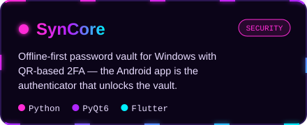</a>
  <a href="https://github.com/phevyy/ParkGuard">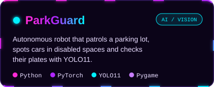</a>
  <a href="https://github.com/phevyy/SybilShield">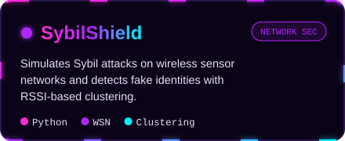</a>
  <a href="https://github.com/phevyy/phevy_dpi">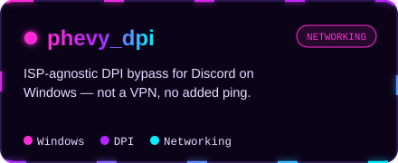</a>

<h3 align="center">🔌 More Network Projects</h3>

  <a href="https://github.com/phevyy/Private-VPN">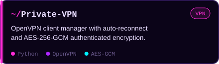</a>
  <a href="https://github.com/phevyy/TCP-UDP">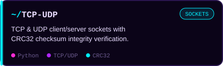</a>
  <a href="https://github.com/phevyy/FTP-ServerwEsp32">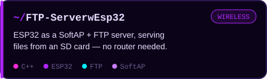</a>
  <a href="https://github.com/phevyy/Intelligent_Ambient_Monitoring_Unit">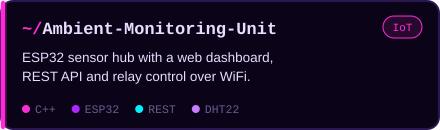</a>

## 🏅 Certifications & Training

  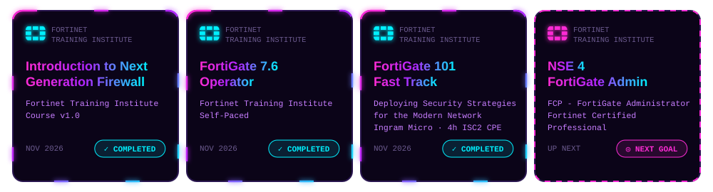

## 🛰️ Network Learning Path

  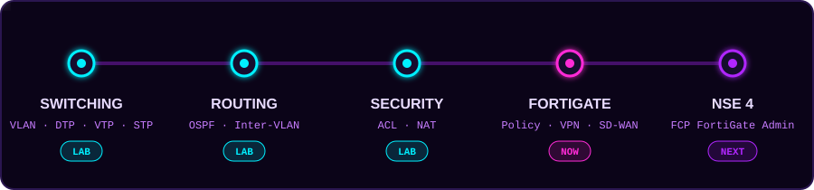

## 🧰 Tech Stack

**Network & Security**

  
  
  
  
  
  
  
  

**Development**

  
  
  
  
  
  
  

## 📊 GitHub Stats

  
  

  

## 🐍 Contribution Graph

  <picture>
    <source media="(prefers-color-scheme: dark)" srcset="https://raw.githubusercontent.com/phevyy/phevyy/output/github-contribution-grid-snake-dark.svg">
    <source media="(prefers-color-scheme: light)" srcset="https://raw.githubusercontent.com/phevyy/phevyy/output/github-contribution-grid-snake.svg">
    
  </picture>

